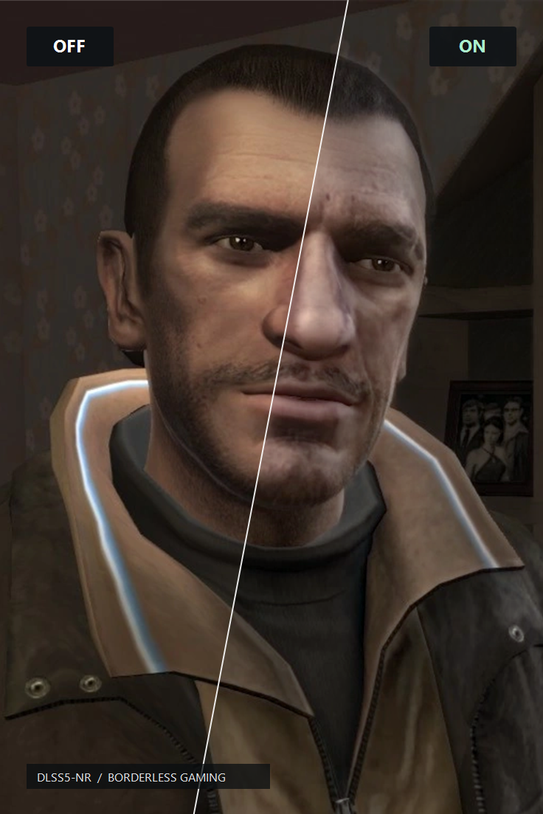
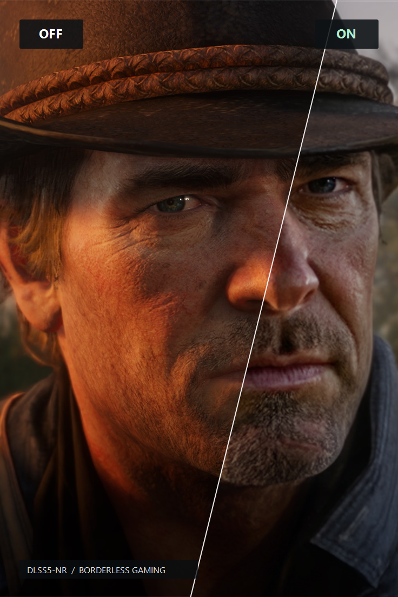
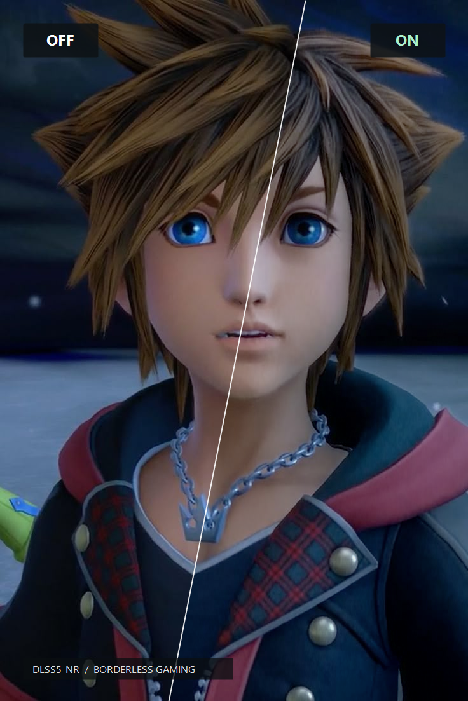

# DLSS5-NR for Borderless Gaming

Bring a new look to familiar games. DLSS5 neural rendering, optimized for Borderless Gaming—with adjustable lighting, tone and structure, on more than just the latest NVIDIA GPUs.

The latest release uses NVIDIA's smaller 310.9.16 model, with lower memory use and a smaller download. GPU processing time is 36–40% lower in 960×960 tests on the RTX 3090 and Intel Arc B580 using DirectX 12 and Vulkan.

[Get Borderless Gaming on Steam](https://store.steampowered.com/app/388080/Borderless_Gaming/) · [Download the effect](https://github.com/andrewmd5/bgfx-dlss5-nr/releases/latest)

<table>
  <tr>
    <td width="33%" align="center" valign="bottom">
      
    </td>
    <td width="33%" align="center" valign="bottom">
      
    </td>
    <td width="33%" align="center" valign="bottom">
      
    </td>
  </tr>
  <tr>
    <td align="center">GTA IV</td>
    <td align="center">RDR2</td>
    <td align="center">Sora</td>
  </tr>
  <tr>
    <td colspan="3" align="center">OFF / ON · Strength 1 · Local tone 1.5 · Structure 2 · Natural · Resolution 950</td>
  </tr>
</table>

## Install

Requires **Borderless Gaming 2.0.12 or newer**. If you used an earlier NR package, update the app and reinstall the effect using these steps.

1. Open the effects editor in Borderless Gaming, or the presets screen in Holo.
2. Choose **Install from GitHub** and paste `https://github.com/andrewmd5/bgfx-dlss5-nr`.
3. Select the **DLSS5-NR** preset and enable effects. On Windows, use **Clone**.

That's it—Borderless Gaming handles the download and setup. No DLLs to copy, no game files to change, and no extra tools to install. Start with the included settings and adjust the look to your taste.

Inference size is adjustable from 320 to 1920 and defaults to 960. The shader package uses DirectX 12 or Vulkan, depending on your renderer and GPU capabilities. DirectX requires Shader Model 6.10 and compatible matrix operations; Vulkan requires compatible cooperative-matrix operations. BGFX checks support before enabling the effect.
